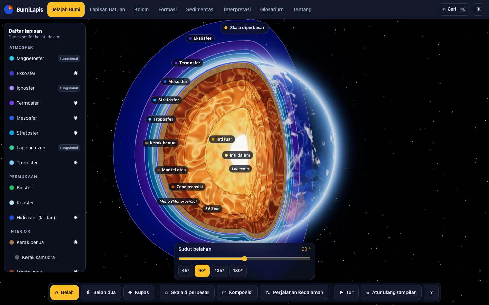
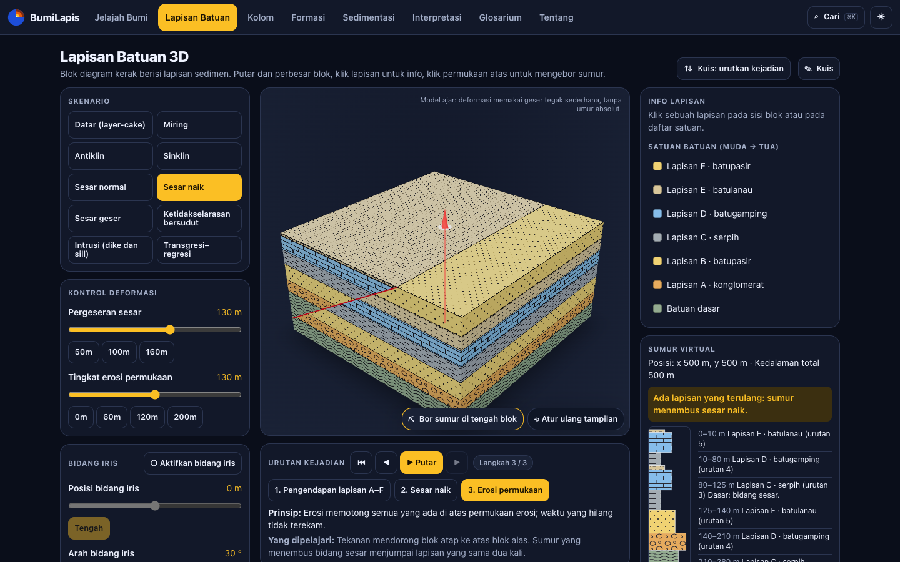
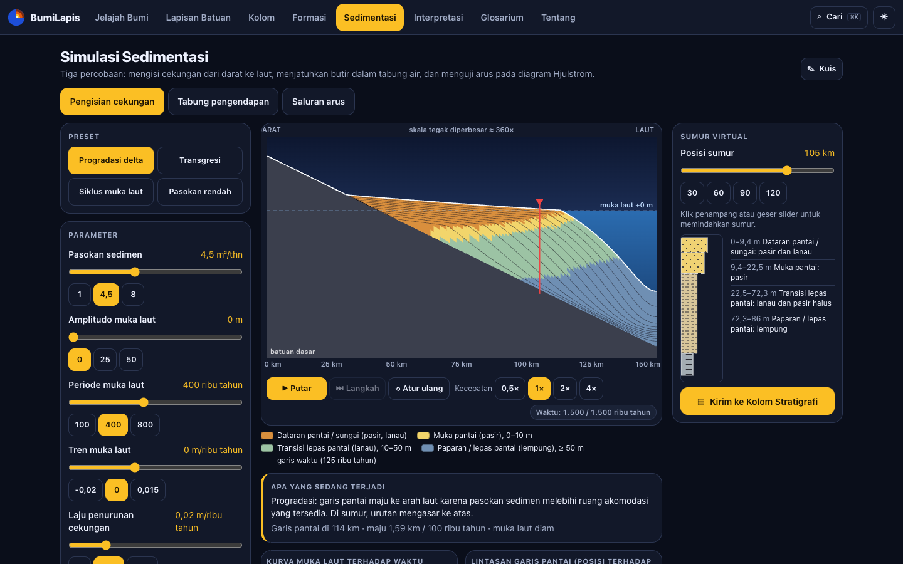
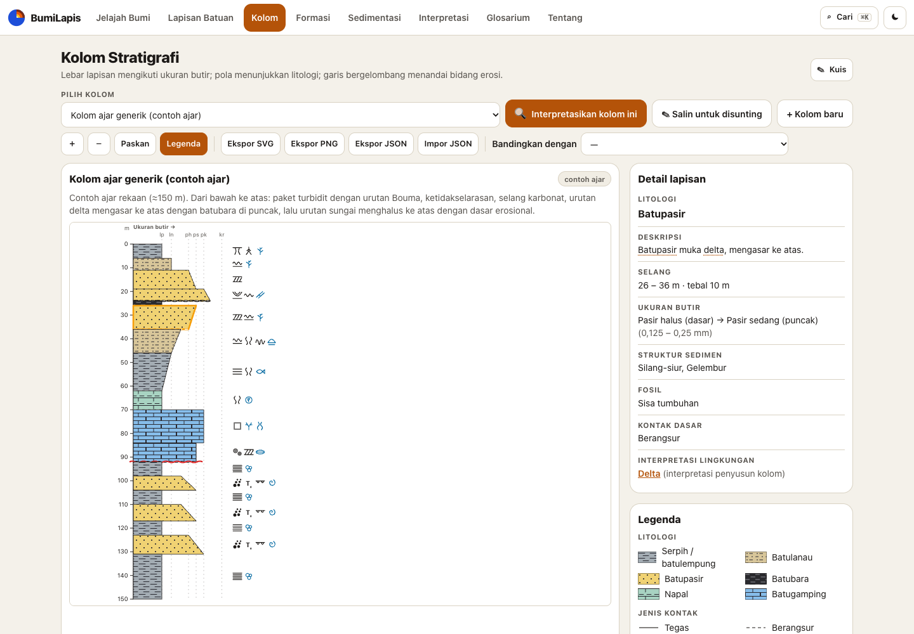
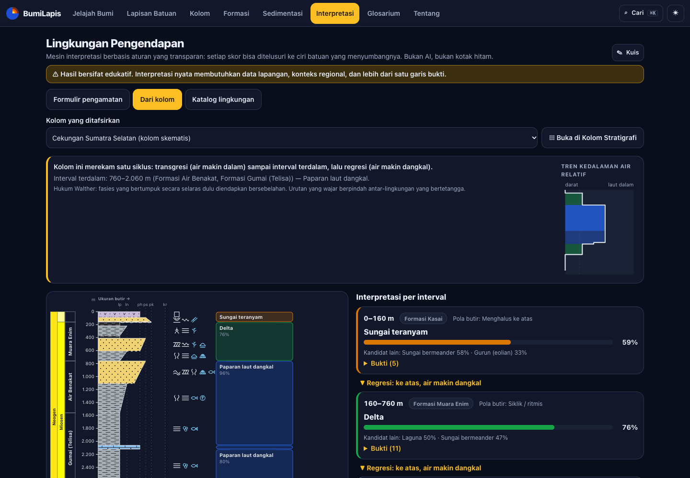

# BumiLapis

Aplikasi web edukasi geosains berbahasa Indonesia. Globe 3D interaktif yang bisa dibelah untuk
menjelajahi semua lapisan Bumi dari eksosfer sampai inti dalam, lalu turun ke skala singkapan:
lapisan batuan, kolom stratigrafi, formasi, simulasi sedimentasi, dan interpretasi lingkungan
pengendapan. Berjalan sepenuhnya di peramban: tanpa backend, tanpa akun, tanpa API key, tanpa
pelacakan, dan tetap bisa dipakai offline setelah dimuat.

**Demo: https://orls967.github.io/BumiLapis3DProject/**



| | |
|---|---|
|  |  |
|  |  |

## Modul

| Rute | Modul | Isi |
|---|---|---|
| `#/` | Jelajah Bumi | Globe 3D (belah, belah dua, kupas), 20+ lapisan dengan panel enam tab, perjalanan kedalaman dengan suhu/tekanan/densitas, mode skala sebenarnya/diperbesar, komposisi/mekanis, tur terpandu, lapisan tambahan |
| `#/lapisan-batuan` | Lapisan Batuan 3D | Blok diagram dengan 10 skenario (lipatan, sesar, ketidakselarasan, intrusi), slider deformasi, bidang iris, sumur virtual, putar ulang urutan kejadian, kuis urutan |
| `#/kolom` | Kolom Stratigrafi | Kolom SVG dengan profil ukuran butir, pola litologi, kontak, simbol; editor; impor/ekspor JSON, SVG, PNG; perbandingan dua kolom dengan garis korelasi |
| `#/formasi` | Formasi Batuan | Studi kasus Cekungan Sumatra Selatan dengan filter dan tautan dua arah ke kolom |
| `#/sedimentasi` | Simulasi Sedimentasi | Pengisian cekungan (difusi 1D di Web Worker), tabung pengendapan, saluran arus dengan diagram Hjulström |
| `#/interpretasi` | Lingkungan Pengendapan | Mesin berbasis aturan yang transparan untuk 14 lingkungan; formulir pengamatan, interpretasi kolom per interval, peringatan Hukum Walther |
| `#/glosarium` | Glosarium | 80+ istilah yang otomatis bertaut dari teks konten |
| `#/tentang` | Tentang | Sumber data, kredit aset, batasan model, data yang perlu verifikasi |

Modul saling terhubung lewat tombol kontekstual: bor sumur di blok 3D atau di simulasi → kolom
stratigrafi → "Interpretasikan kolom ini". Pencarian global: `Ctrl/⌘ + K`.

## Menjalankan

Butuh Node.js 20 atau lebih baru.

```bash
npm install
npm run dev        # http://localhost:5173
```

| Perintah | Guna |
|---|---|
| `npm run build` | `tsc --noEmit` lalu build produksi ke `dist/` |
| `npm run preview` | Menyajikan `dist/` |
| `npm run lint` · `npm run typecheck` | ESLint · TypeScript |
| `npm run test` | Unit dan komponen (Vitest) |
| `npm run e2e` | Uji asap Playwright terhadap build produksi (`npx playwright install chromium` sekali) |
| `node scripts/shots.mjs out.png '#/rute' 1440x900` | Tangkapan layar untuk memeriksa tampilan |

Hasil build memakai `base: './'` dan HashRouter, jadi bisa disajikan dari subfolder mana pun
tanpa konfigurasi server.

## Struktur

```
src/
├─ content/   data ilmiah + teks UI (divalidasi Zod saat test)
├─ lib/       logika murni dan teruji: profile, strata, sedsim, interpret
├─ scene/     komponen react-three-fiber (earth, strata)
├─ ui/        komponen UI bersama (kolom SVG, slider, tab, pencarian)
├─ pages/     satu folder per rute
├─ store/     state Zustand
└─ workers/   sedsim.worker.ts
tests/        uji asap Playwright
docs/         PROGRESS.md, PUBLIKASI.md, screenshots/
```

Stack: Vite, React, TypeScript strict, three.js lewat @react-three/fiber + drei +
postprocessing, Zustand, React Router (HashRouter), Tailwind CSS v4, d3-scale/d3-shape, Zod,
Vitest, Playwright.

## Batasan model

Aplikasi ini alat belajar, bukan alat ukur.

- **Skala.** Mode "skala diperbesar" menebalkan atmosfer, laut, dan kerak agar terlihat dan
  selalu berlabel; mode "skala sebenarnya" tersedia. Penampang simulasi cekungan memakai skala
  tegak yang sangat diperbesar (tertulis di gambar).
- **Interior Bumi.** Densitas dan tekanan mengikuti titik-titik PREM dan diinterpolasi linear;
  suhu adalah perkiraan berupa rentang.
- **Blok batuan.** Deformasi memakai geser tegak sederhana, tanpa umur absolut.
- **Simulasi cekungan.** Difusi 1D dengan fluks konservatif. Daya angkut di laut melemah
  terhadap kedalaman dan batuan dasar tidak tererosi; hasilnya kualitatif.
- **Diagram Hjulström.** Empiris dan kualitatif; kurva didigitasi secara pendekatan.
- **Interpretasi.** Aturan berbobot sederhana; setiap skor bisa ditelusuri ke aturannya.
  Interpretasi nyata membutuhkan data lapangan.
- **Formasi.** Ringkasan umum dari literatur; entri yang belum dirujuk ke sumber primer berlabel
  "perlu verifikasi" (daftarnya di halaman Tentang dan `docs/PROGRESS.md`).

## Sumber

Dziewonski & Anderson (1981) PREM; U.S. Standard Atmosphere (1976); Ferguson & Church (2004);
Hjulström (1935); Boggs, *Principles of Sedimentology and Stratigraphy*; Nichols,
*Sedimentology and Stratigraphy*; Bishop (2001) USGS OFR 99-50-S; De Coster (1974); ICS
International Chronostratigraphic Chart; FGDC-STD-013 (acuan gaya pola, digambar sendiri);
NASA Visible Earth. Daftar lengkap ada di halaman Tentang; kredit dan lisensi aset di
[`CREDITS.md`](CREDITS.md).

Bukan produk dan tidak berafiliasi dengan penyedia peta atau globe mana pun.

## Lisensi

Kode: MIT (lihat [`LICENSE`](LICENSE)). Tekstur Bumi: domain publik (NASA).
